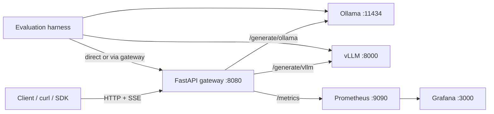

# Local LLMOps Lab

[](https://github.com/AhmedRushdy/LocalLLMOps/actions/workflows/ci.yml)

A local-first LLMOps reference stack: a single FastAPI gateway in front of
**Ollama** and **vLLM**, with streaming, token accounting, health probes,
Prometheus metrics, a provisioned Grafana dashboard, and an evaluation +
benchmark harness.

It is built to answer the operational questions you actually hit when serving
LLMs: *Is the model loaded? How long until the first token? How many tokens did
we generate? Which backend is slow? Did quality regress?*

No cloud account required — it runs on one machine.

---

## Features

- **One API, two engines** — `/generate/ollama` and `/generate/vllm` share the
  same request/response contract, plus a `?backend=` selector.
- **Streaming** — Server-Sent Events at `/generate/{backend}/stream`, with
  `token`, `done` and `error` events.
- **Model-aware health** — `/health`, `/readyz` and `/livez` verify that the
  *configured model* is actually being served, not just that the daemon is up.
- **Token accounting** — prompt/completion/total tokens are returned in every
  response and exported to Prometheus.
- **Serving metrics** — time-to-first-token, generation latency, token
  throughput, backend readiness and in-flight request gauges.
- **Backpressure** — per-backend semaphore (`MAX_CONCURRENT_REQUESTS`) and a
  bounded HTTP connection pool.
- **Observability stack** — Prometheus scrape config, alert rules and an
  auto-provisioned Grafana dashboard.
- **Evaluation gate** — rule-based eval runner with `--fail-under` so CI can
  fail on quality regressions.
- **Reproducible packaging** — pinned dependencies, non-root image, container
  healthcheck, `docker compose` build, GitHub Actions CI.

---

## Architecture



The gateway owns request IDs, logging, validation, error mapping, metrics and
concurrency. Backends own model execution.

---

## Quickstart

### Prerequisites

- Python 3.12
- [Ollama](https://ollama.com/) running locally
- Optional: vLLM + a GPU (the API works with only one backend available)
- Optional: Docker / Docker Compose

### 1. Start the backends

```bash
ollama serve
ollama pull qwen2.5:0.5b

# Optional, GPU:
vllm serve Qwen/Qwen2.5-0.5B-Instruct --port 8000
```

### 2. Run the API natively

```bash
python -m venv .venv
source .venv/bin/activate
pip install -r requirements-dev.txt
uvicorn app.main:app --port 8080
```

### 3. Or run the whole stack with Docker Compose

```bash
cp .env.example .env
docker compose up --build -d
```

> `compose.yaml` uses `network_mode: host`, so the API reaches Ollama/vLLM on
> `127.0.0.1`. Host networking is Linux-only. On macOS/Windows, run the API
> natively or switch to a bridge network and set `OLLAMA_URL`/`VLLM_URL` to
> `host.docker.internal`.

### 4. Smoke test

```bash
curl -s localhost:8080/livez
curl -s localhost:8080/readyz
curl -s localhost:8080/generate/ollama \
  -H 'Content-Type: application/json' \
  -d '{"prompt":"What is LLMOps? Answer in two sentences.","max_tokens":60}'
```

Stream tokens as they are generated:

```bash
curl -N -s localhost:8080/generate/vllm/stream \
  -H 'Content-Type: application/json' \
  -d '{"prompt":"Explain LLMOps in three bullets.","max_tokens":80}'
```

```
event: token
data: {"delta": "LLMOps"}

event: token
data: {"delta": " stands"}

event: done
data: {"request_id":"...","backend":"vllm","model":"...","response":"...","latency_seconds":1.23,"time_to_first_token_seconds":0.18,"usage":{"prompt_tokens":14,"completion_tokens":62,"total_tokens":76}}
```

---

## API

| Method | Path | Purpose |
|---|---|---|
| `GET` | `/` | Service discovery |
| `GET` | `/livez` | Liveness — process is up (never checks backends) |
| `GET` | `/readyz` | Readiness — at least one backend serves its configured model |
| `GET` | `/health` | Detailed health — 200 only if **all** backends are ready |
| `GET` | `/health/{backend}` | Per-backend detail (`ollama` or `vllm`) |
| `GET` | `/metrics` | Prometheus exposition |
| `POST` | `/generate/ollama` | Non-streaming generation |
| `POST` | `/generate/vllm` | Non-streaming generation |
| `POST` | `/generate?backend=ollama` | Non-streaming generation, backend as query param |
| `POST` | `/generate/{backend}/stream` | SSE streaming generation |

Request body:

```json
{
  "prompt": "What is model inference?",
  "max_tokens": 120,
  "temperature": 0.0
}
```

`prompt` is 1–8000 chars, `max_tokens` 1–512, `temperature` 0–2.

Response:

```json
{
  "request_id": "8f0c...",
  "backend": "ollama",
  "model": "qwen2.5:0.5b",
  "response": "Model inference is ...",
  "latency_seconds": 0.187,
  "time_to_first_token_seconds": null,
  "usage": {
    "prompt_tokens": 9,
    "completion_tokens": 44,
    "total_tokens": 53
  }
}
```

Errors are mapped consistently: `504` backend timeout, `502` backend error or
malformed payload, `503` backend unreachable, `400/404` unknown backend,
`422` validation. `X-Request-ID` is echoed on every response and accepted from
the caller.

Interactive docs: <http://localhost:8080/docs>

### Health semantics

- `/livez` answers `200` while the process runs. Use it for container
  restarts.
- `/readyz` answers `200` if **any** backend can serve its configured model.
  Use it for load-balancer readiness when one engine is enough.
- `/health` answers `200` only when **both** backends are ready, and includes
  `available_models` so you can see a model-tag mismatch. Use it for
  dashboards and humans.

`backend_status` is one of `ok`, `model_missing` or `unavailable`.

---

## Configuration

| Variable | Default | Description |
|---|---|---|
| `OLLAMA_URL` | `http://localhost:11434` | Ollama base URL |
| `VLLM_URL` | `http://localhost:8000` | vLLM base URL |
| `OLLAMA_MODEL` | `qwen2.5:0.5b` | Model that must be loaded in Ollama |
| `VLLM_MODEL` | `Qwen/Qwen2.5-0.5B-Instruct` | Model that must be served by vLLM |
| `REQUEST_TIMEOUT` | `120` | Upstream read timeout (seconds) |
| `CONNECT_TIMEOUT` | `10` | Upstream connect timeout (seconds) |
| `HEALTH_TIMEOUT` | `5` | Health probe timeout (seconds) |
| `HEALTH_PROBE_INTERVAL` | `15` | Background probe interval; `0` disables |
| `MAX_CONCURRENT_REQUESTS` | `8` | Per-backend in-flight cap |
| `MAX_CONNECTIONS` | `100` | HTTP connection pool size |
| `LOG_LEVEL` | `INFO` | Log level |
| `GRAFANA_ADMIN_USER` | `admin` | Grafana admin user (Compose) |
| `GRAFANA_ADMIN_PASSWORD` | `local-lab-admin` | Grafana admin password (Compose) |
| `API_URL` | `http://localhost:8080` | Gateway URL used by the eval harness |

Copy `.env.example` to `.env` for Compose.

---

## Observability

Start the stack with Compose, then open:

- Grafana: <http://localhost:3000> (dashboard **LLMOps API Overview** is
  provisioned automatically)
- Prometheus: <http://localhost:9090> (alerts under **Alerts**)

Exported metrics:

| Metric | Type | Labels |
|---|---|---|
| `llmops_http_requests_total` | counter | `method`, `endpoint`, `status` |
| `llmops_http_request_duration_seconds` | histogram | `method`, `endpoint` |
| `llmops_http_errors_total` | counter | `method`, `endpoint`, `status` |
| `llmops_backend_up` | gauge | `backend` |
| `llmops_inflight_requests` | gauge | `backend` |
| `llmops_generation_duration_seconds` | histogram | `backend` |
| `llmops_time_to_first_token_seconds` | histogram | `backend` |
| `llmops_tokens_total` | counter | `backend`, `type` (`prompt`/`completion`) |

`endpoint` uses the route template (e.g. `/generate/{backend}/stream`), and
unmatched paths collapse to `unmatched`, so label cardinality stays bounded.

Alert rules in [`monitoring/prometheus/alerts.yml`](monitoring/prometheus/alerts.yml)
cover backend down, >5% 5xx, p95 generation latency >30s, and queue saturation.
No Alertmanager receiver is wired; alerts are visible in the Prometheus UI.

> Note: the background prober refreshes `llmops_backend_up` every
> `HEALTH_PROBE_INTERVAL` seconds. Health endpoints also refresh it on demand.

---

## Evaluation

The dataset is [`evaluation/dataset.jsonl`](evaluation/dataset.jsonl) — five
rule-checked cases (required phrases, alternatives, numbered/bullet counts).

```bash
# Direct to Ollama
python -m evaluation.evaluate --backend ollama

# Direct to vLLM
python -m evaluation.evaluate --backend vllm

# Through the gateway (tests the whole request path)
python -m evaluation.evaluate --backend gateway --gateway-backend vllm

# CI-style quality gate: exit 1 below 80%
python -m evaluation.evaluate --backend gateway --fail-under 0.8
```

Reports are written to `results/` (`evaluation.json`,
`evaluation-vllm.json`, `evaluation-gateway.json`).

Current baseline: **4/5 (80%)** for both engines. The one failure is the
`llmops_definition` case — the 0.5B model hallucinates the expansion of
LLMOps. That is the point of the harness, and it is also a reminder that
substring checks are only a first line of defence (see
[Limitations](#limitations--roadmap)).

---

## Benchmarks

| Script | What it measures |
|---|---|
| `scripts/benchmark.py` | Ollama, cold start included (legacy) |
| `scripts/benchmark_ollama_fair.py` | Ollama, warm-up excluded |
| `scripts/benchmark_vllm.py` | vLLM, warm-up excluded |

Recorded single-stream results (3 prompts × 3 repeats, `max_tokens=60`,
0.5B model, one host):

| Engine | Samples | Median latency | Mean latency | HTTP throughput |
|---|---:|---:|---:|---:|
| Ollama | 9 | 0.171 s | 0.174 s | 298.7 tok/s |
| vLLM | 9 | 0.869 s | 0.829 s | 68.4 tok/s |

**Read this carefully:** these are single-stream, end-to-end HTTP numbers, not
a fair engine comparison. vLLM is optimized for *batched* throughput; its
advantage appears with concurrent requests and longer contexts, which this
harness does not exercise. `benchmark.csv` also contains a 4.6s cold-start
sample (median 0.213s vs mean 0.694s), and `benchmark-baseline.csv` is an
identical copy — prefer the `*-fair` files.

---

## Testing

```bash
pip install -r requirements-dev.txt
pytest -q
```

25 tests cover validation, both adapters, request-ID propagation, streaming
SSE parsing, model-aware health, readiness, error mapping and metrics
exposure. Upstreams are mocked; no GPU or running model is required.

CI ([`.github/workflows/ci.yml`](.github/workflows/ci.yml)) compiles the
packages, runs the test suite and builds the Docker image on every push/PR.

---

## Project layout

```
.
├── app/
│   └── main.py                 # FastAPI gateway
├── evaluation/
│   ├── evaluate.py             # Eval runner + quality gate
│   └── dataset.jsonl           # 5 rule-checked cases
├── scripts/
│   ├── benchmark.py            # Legacy Ollama benchmark
│   ├── benchmark_ollama_fair.py
│   ├── benchmark_vllm.py
│   ├── evaluate_vllm.py        # Wrapper around evaluate.py
│   └── commands.sh             # Example curl
├── monitoring/
│   ├── prometheus/             # Scrape config + alert rules
│   └── grafana/                # Datasource, dashboard provisioning, JSON
├── results/                    # Recorded eval/benchmark reports
├── tests/                      # pytest suite (mocked upstreams)
├── Dockerfile                  # Non-root image + healthcheck
├── compose.yaml                # API + Prometheus + Grafana
├── requirements-api.txt        # Pinned runtime deps
└── requirements-dev.txt        # Runtime + test deps
```

---

## Limitations & roadmap

- **Eval is rule-based and tiny.** No semantic/LLM judge, no factuality check,
  no safety cases. A wrong answer can pass on formatting alone.
- **No auth, TLS or per-client rate limits.** The only protection is the
  per-backend concurrency cap. Do not expose this to an untrusted network.
- **Benchmarks are single-stream.** Add a concurrency sweep (k6/Locust) and
  record GPU model, dtype and quantization for a defensible engine comparison.
- **No tracing or GPU telemetry.** Next step: OpenTelemetry spans and
  DCGM/nvidia-smi exporters.
- **Floating image tags** for Prometheus/Grafana (`latest`); pin digests for
  reproducibility.
- **No Alertmanager receiver**, so alerts do not page anyone yet.
- **No LICENSE** file yet.

---
